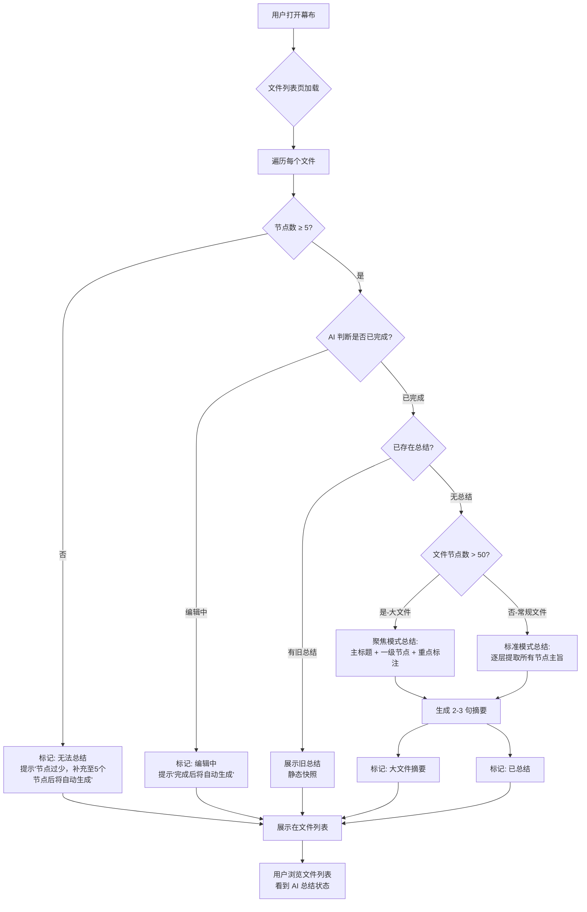
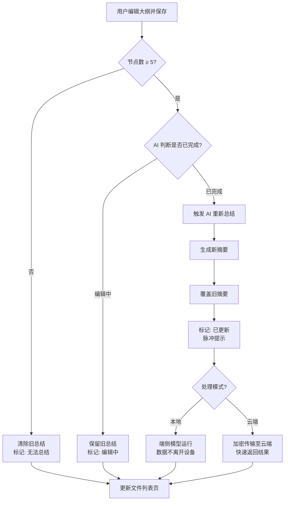
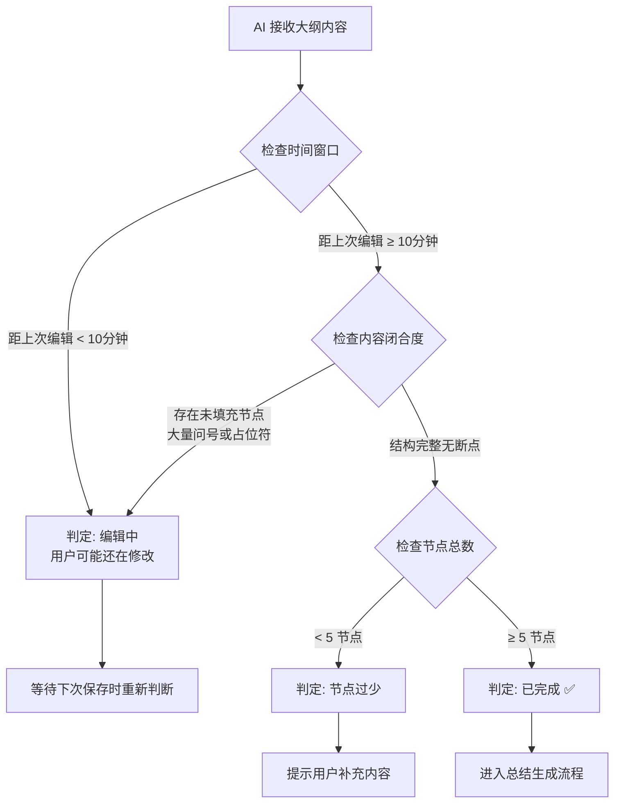
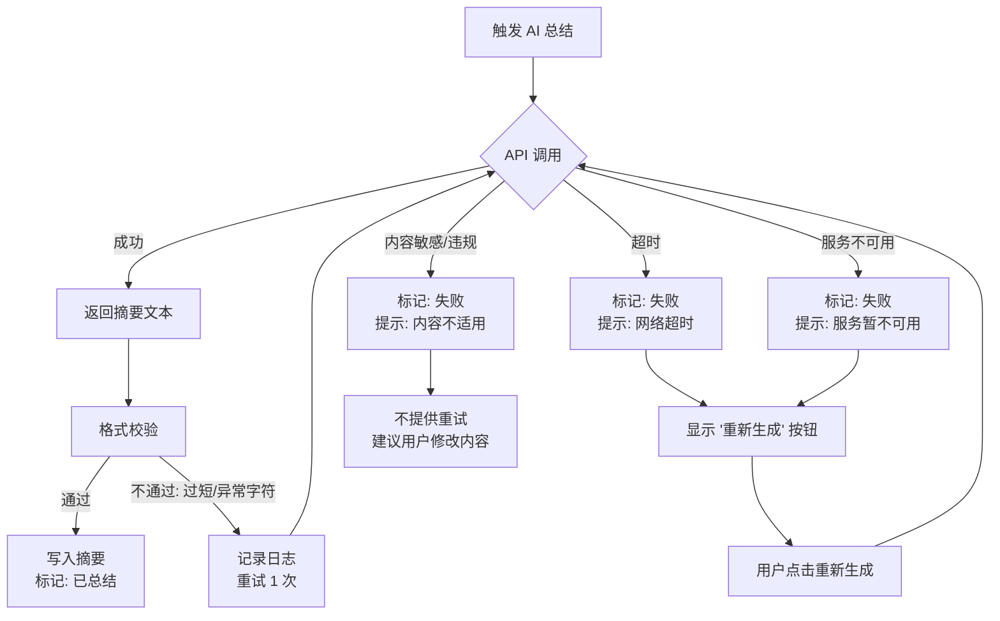
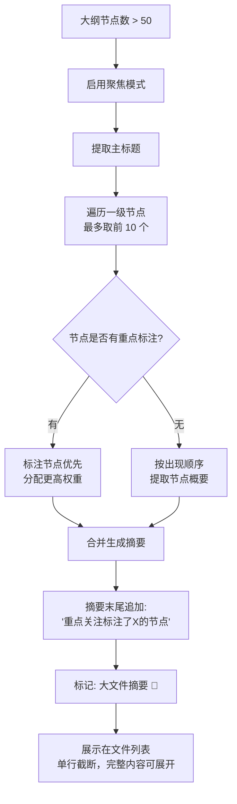
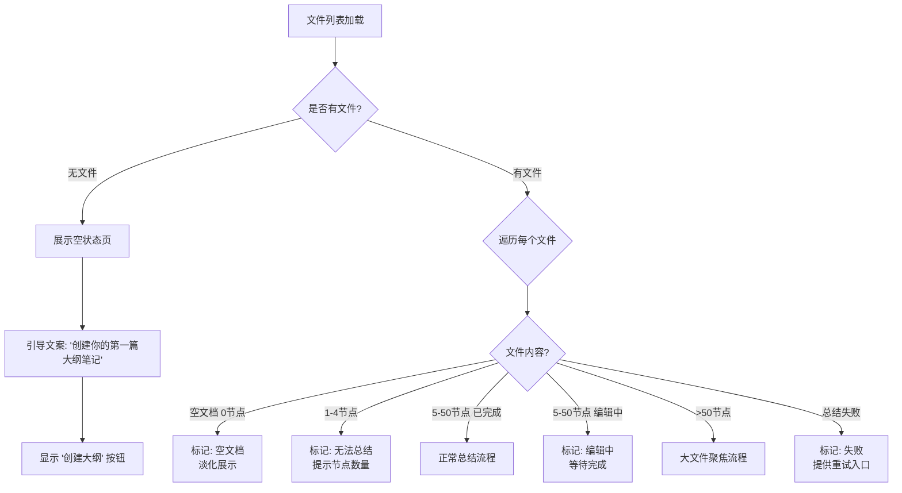
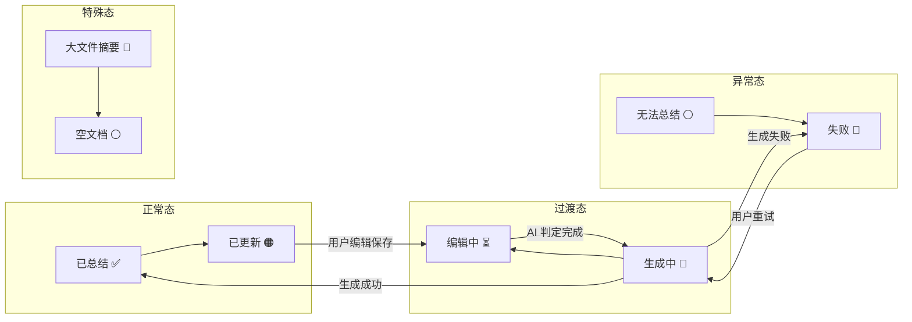

# 幕布 AI 智能总结 — 流程图 v1.1

> **版本**: v1.1 | **日期**: 2026-06-01 | **上一版本**: [v1.0](./flowchart_v1.0.md)
> 
> **v1.1 变更**: 版本迭代管理体系建设，流程图内容与 v1.0 保持一致，随功能迭代同步更新。

## 1. 主线流程：AI 总结生成与展示

---

## 2. 更新触发流程：用户编辑后自动刷新

---

## 3. 完成度判断逻辑

---

## 4. 异常处理流程

---

## 5. 隐私模式选择流程

```mermaid
flowchart TD
    A[用户首次使用 AI 总结] --> B[弹出隐私选择面板]
    
    B --> C{用户选择}
    C -->|本地处理 🔒| D[启用端侧 AI 模型]
    D --> E[优点: 数据不离开设备，完全隐私]
    D --> F[缺点: 处理速度较慢，模型能力有限]
    E --> G[保存用户偏好]
    F --> G
    
    C -->|云端处理 ☁️| H[启用云端 API]
    H --> I[优点: 速度快，模型能力强]
    H --> J[缺点: 数据加密传输，存在传输风险]
    I --> K[保存用户偏好]
    J --> K
    
    G --> L[后续总结按偏好执行]
    K --> L
    
    L --> M{用户可在设置中随时切换}
    M -->|切换| B
```

---

## 6. 大文件聚焦总结流程

---

## 7. 空状态与边界

---

## 附图：文件列表状态映射总览

---

> 以上为 v1.0 流程图，覆盖了主操作链路、异常流程（超时/失败/重试）、隐私选择、大文件处理、空状态边界。待原型确认无遗漏后，将整合进最终版 PRD。
